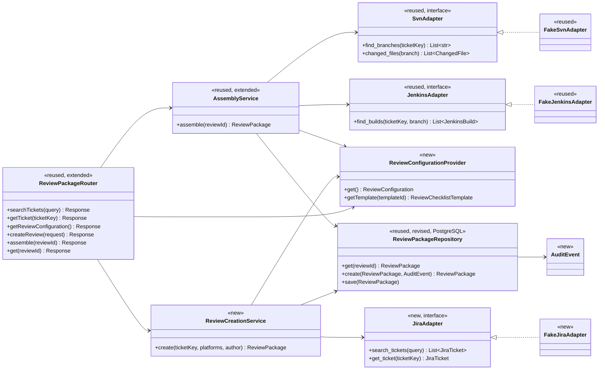
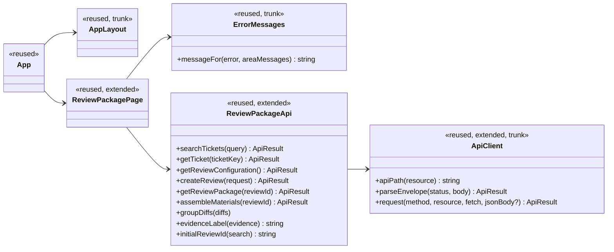
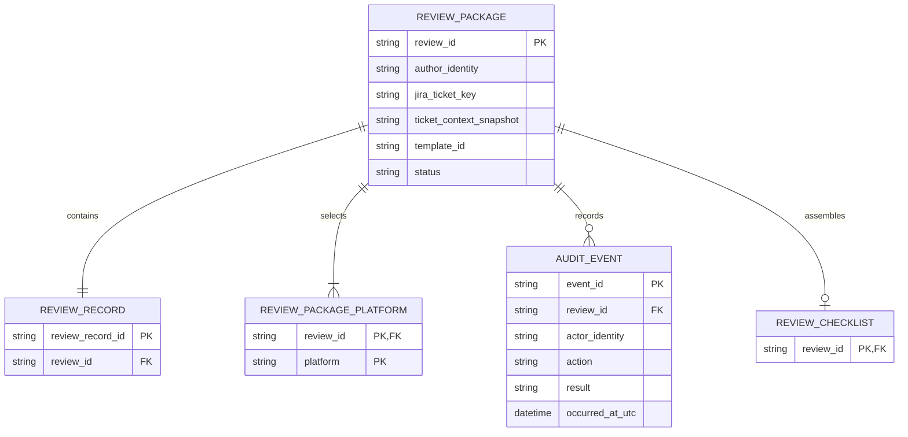
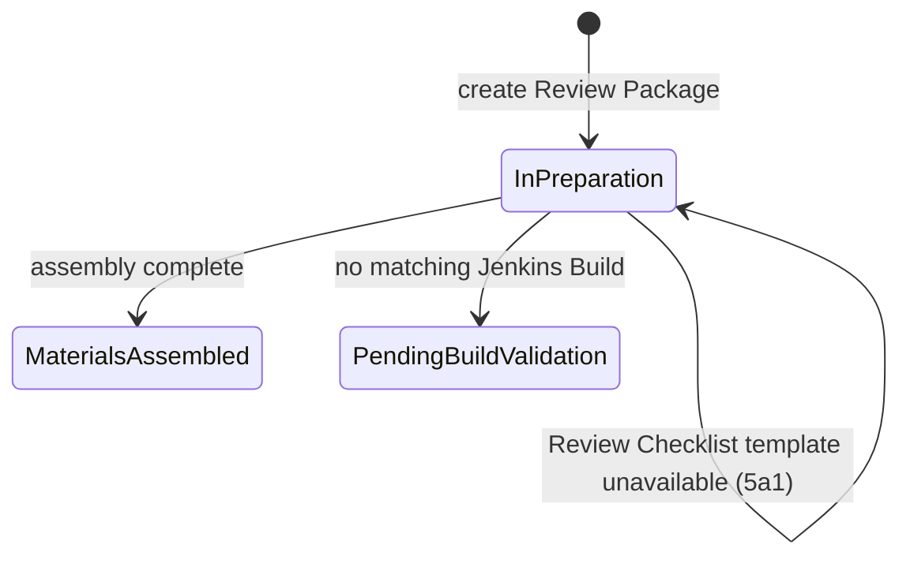

# Review Preparation Design

**Project:** RevView/OMNI
**Team:** Team 8
**Area:** `UC-REV`

> **Realizes:** [`UC-REV-create-review`](../requirements/use-cases.md#uc-rev-create-review-create-a-review-package); [`UC-REV-assemble-materials`](../requirements/use-cases.md#uc-rev-assemble-materials-assemble-review-materials) (main success scenario, extensions 2a1, 4a1, and 5a1; the review package page, issue #51)
> **Depends on:** `BR-review-package-required`, `BR-review-nine-parts`, `BR-svn-diff-required`, `BR-diff-checklist-match` ([business rules](../requirements/business-rules.md), read as the [2026-11-06 client meeting](../requirements/client-meeting/client-interview-2026-11-06.md) reshaped them); `SI-jira-read`, `SI-svn-read`, `SI-jenkins-read`, `ROB-incomplete-package-blocked`, `SEC-authenticated-access`, `SEC-role-based-review-access`, `CO-backend-language`, `CO-frontend-language`, `CO-database`, `CO-sandbox-development`, `FR-AUDIT-action-log` ([specification](../requirements/software-requirements-specification.md)); [architecture-of-record](architectural-design.md) sections 8.1, 8.2.1–8.2.10
> **See:** [use cases](../requirements/use-cases.md), [specification](../requirements/software-requirements-specification.md), [architecture-of-record](architectural-design.md), [glossary](../requirements/project-glossary.md)
> **Designed against:** `6aeade1` (`main`, merged PR #55); existing application code from its first parent, `062bd2a`

---

_**How to use this template.** Copy it to `docs/design/<area>.md`, named for the lowercase area code (`ord.md` for `UC-ORD-*`). Instructions appear in italic square brackets; leave them in place until the document is stable, because the agent reads them on every later pass. The full worked example is Project Pulse's [`not.md`](https://github.com/Washingtonwei/project-pulse/blob/main/docs/design/not.md); read it for the shape, not for the answers._

_**What this document is.** The **design-of-record** for one use case area: how the code will realize its use cases, written **before** the code and approved before anyone builds from it. It is the last document your agent reads before it writes code, so anything it leaves out, the agent invents._

_**What it is not.** A copy of your use cases. It **cites** `UC-*`, `FR-*`, and `BR-*` by identifier and never restates what the system shall do; it says only how._

_**One document per area, not per use case.** The overview, the class diagram, and the data model are **revised in place**. The sequence diagrams, the API contract rows, and the test rows are **appended**, one set per use case. Never add a `## UC-…` section that repeats the whole skeleton._

_**How much to write.** Pin down what a wrong guess would break: a requirement, a business rule, a quality attribute, or the contract between two parts of your team. Leave the rest for the agent to derive while it builds._

---

## Overview

_[One paragraph: what this area does, which components of the architecture-of-record it lives in, and what it reads from or calls in other areas.]_

Review Preparation creates a Review Package from an Author-selected Jira Ticket, records the Author and affected Platforms, and then assembles the ticket context and review evidence. It is the `REV` area's Review Preparation component ([use case areas](architectural-design.md#52-use-case-areas-and-components)); Jira, SVN, and Jenkins are reached only through Integration Gateway adapters (section 8.2.4).

**v0.1.0 implementation boundary:** the review-package page and assembly endpoint use a seeded Synthetic Data package, fake SVN/Jenkins adapters, and an in-memory repository. `UC-REV-create-review` replaces that fixture entry point. The PostgreSQL repository required by `CO-database`, a sandbox Jira adapter, and authenticated access are part of the target design; identity-provider details remain open in `OI-23`.

**Package shape.** The shape follows the 2026-11-06 meeting (`OI-31`, `OI-36`), now reflected in specification section 7.1 and business-rules.md section 2.1 (PR #55). A package has one Review Checklist with Platform tabs, one Review Record, and one Diff per Platform × Code/Tools/Tests Category the change touches, up to nine. The template and treatment of unaffected tabs remain open (`OI-44`); creation must use configured template data and must not claim an unavailable template is ready.

**The review package page.** An Author can search and select a Jira Ticket, review its context, choose Platforms, and create the package. The page then starts the existing assembly operation and shows the package and any actionable gap or error. It runs in the Web Interface container ([section 5.1](architectural-design.md#51-containers)); the browser never calls Jira directly. The shared frontend shell, API client, and error-envelope handling remain reusable by later use cases.

## Components & classes

_[One class diagram for the whole area, and one line per class or file saying what it does and whether it is **new** or **reused**. If the repository has no code for this area yet, list the files you expect the agent to create and mark them all new.]_



- `backend/app/rev/router.py` (reused, extended): versioned endpoints; request-shape checks remain at the boundary, with authoritative validation in the services.
- `backend/app/rev/creation.py` (new): `ReviewCreationService`; validates the selected Jira Ticket and Platform choices, creates the package and its single Review Record, and records the creation audit event in the same transaction.
- `backend/app/rev/configuration.py` (new): reads supported Platforms and configured Review Checklist templates; reports missing configuration explicitly.
- `backend/app/rev/assembly.py` (reused, extended if needed): assembles from the Jira context saved on the Review Package; it must preserve the Review Record created with the package.
- `backend/app/rev/models.py` (reused, extended): Jira Ticket context snapshot, selected Platforms, Author identity, existing Review Package and evidence models.
- `backend/app/rev/repository.py` (reused, revised): PostgreSQL persistence behind the existing repository boundary; package, Review Record, and creation Audit Event are committed atomically.
- `backend/app/integration/jira.py` (new): `JiraAdapter` and `FakeJiraAdapter`, with read-only ticket search and retrieval. Use Synthetic Data in tests; no production Jira access.
- `backend/app/integration/common.py`, `svn.py`, and `jenkins.py` (reused): shared integration failure and existing adapter contracts.
- Identity and authorization (new integration with the existing Identity component): each endpoint derives the Author from the authenticated request, never from a client-supplied identity. `OI-23` still blocks selecting a concrete provider/protocol.
- `backend/app/errors.py` and `backend/app/main.py` (reused): use the existing trust-boundary envelope for Jira, validation, authorization, and unexpected failures.
- `backend/app/audit.py` (new) and the PostgreSQL repository (extended): persist the package-creation Audit Event with the package and Review Record.
- The adapters and repository are FastAPI dependencies so tests can substitute fakes. A PostgreSQL driver is not named or added until a person confirms the dependency, as required by the team charter.

### The review package page (issue #51)



All under `frontend/`. **Trunk** marks shared code later use cases reuse.

- `src/api.ts` (reused, extended, **trunk**): keeps `apiPath`, envelope parsing, and `request`; extend `request` to send an optional JSON body with the required content type for Review Package creation.
- `src/errors.ts` (reused, **trunk**): shared codes and fallback remain unchanged; area messages stay in `reviewPackage.ts`.
- `src/AppLayout.tsx` (reused, **trunk**): existing product shell and main region.
- `src/App.tsx` (reused): continues to render `AppLayout` around `ReviewPackagePage`.
- `src/rev/reviewPackage.ts` (reused, extended): package types and load/assembly calls plus ticket search/detail, review configuration, and create calls; adds creation and template error messages; retains grouping, evidence, and review-id helpers. Build timestamps use the configured organization time zone; hide them until `OI-39` is answered.
- `src/rev/ReviewPackagePage.tsx` (reused, extended): adds Jira Ticket search and selection, retrieved-context display, Platform selection, and Create. Package-context edits remain out until `OI-49` is answered. After a successful create it immediately invokes the assembly API and updates the same view with its result; the created review id remains visible if assembly fails, so the Author can resume without creating a duplicate. Existing Load/Assemble behavior remains available for an existing package.
- `vite.config.ts` and `README.md` (reused): the existing development proxy and "Run the page" instructions need no change.
- Tests: `src/api.test.ts` (extended for JSON request bodies), `src/rev/reviewPackage.test.ts` (extended for create/configuration calls and error messages); existing `src/errors.test.ts` remains unchanged. No new packages.

## Sequence

_[One sequence diagram per use case for its main success scenario. **Label each interaction with the use case step it implements.** Use `alt` blocks for extensions.]_

### UC-REV-create-review: creating a review package

```mermaid
sequenceDiagram
    actor A as Author
    participant P as ReviewPackagePage
    participant C as ApiClient
    participant API as Application /api/v1
    participant R as ReviewCreationService
    participant J as JiraAdapter
    participant DB as ReviewPackageRepository
    participant AS as AssemblyService

    A->>P: Search/select a Jira Ticket (step 1)
    P->>C: searchTickets(query) (step 1)
    C->>API: GET /jira-tickets?query=... (step 1)
    API->>J: search_tickets(query) (step 1)
    J-->>API: matching ticket summaries (step 1)
    API-->>P: ticket summaries (step 1)
    P->>C: getTicket(ticketKey) (step 1)
    C->>API: GET /jira-tickets/{ticketKey} (step 1)
    API->>J: get_ticket(ticketKey) (step 1)
    J-->>API: ticket identity and approved change context (step 1)
    API-->>P: ticket detail envelope (step 1)
    P->>C: getReviewConfiguration() (step 2)
    C->>API: GET /review-configuration (step 2)
    API-->>P: supported Platforms and configured Review Checklist template (step 2)
    P-->>A: show ticket context, Platform choices, and template (steps 1–2)
    A->>P: select Platforms and confirm review metadata (step 3)
    P->>C: createReview(ticketKey, platforms) (step 3)
    C->>API: POST /review-packages (step 3)
    API->>R: create(request, authenticated Author) (steps 3–4)
    R->>R: validate selected Platforms (step 3)
    alt unsupported Platform (3a)
        R-->>API: 422 PLATFORM_UNSUPPORTED with the supported Platform values (step 3a1)
        API-->>P: safe error envelope; no Review Package is created (step 3a1)
        A->>P: choose a valid Platform combination (step 3a2)
        P-->>A: resume at Platform selection (step 3a2)
    else supported Platforms
        R->>J: get_ticket(ticketKey), retrieve context for the package snapshot (steps 1, 3)
        alt missing or incomplete Jira Ticket (1a)
            J-->>R: ticket absent or required description missing (step 1a1)
            R-->>API: 404 JIRA_TICKET_NOT_FOUND or 422 JIRA_TICKET_INCOMPLETE (step 1a1)
            API-->>P: safe error envelope; no Review Package is created (step 1a1)
            A->>P: correct the ticket reference and select again (step 1a2)
            P-->>A: resume ticket search/selection (step 1a2)
        else Jira unavailable
            J-->>R: IntegrationUnavailable(Jira) (step 1, SI-jira-read, 8.2.1)
            R-->>API: JIRA_UNAVAILABLE (step 1, 8.2.1)
            API-->>P: 503 JIRA_UNAVAILABLE, source "Jira" (step 1, 8.2.1)
        else valid Jira Ticket
            J-->>R: verified Jira Ticket context (steps 1, 3)
            R->>DB: atomically create Review Package with template id, one Review Record, Audit Event (step 4)
            DB-->>R: persisted package (step 4)
            R-->>API: package with unique review id, status "In preparation" (step 4)
            API-->>P: 201, package envelope (step 4)
            P-->>A: display the created package in "In preparation" (step 6)
            P->>C: assembleMaterials(reviewId), automatically after create (step 5)
            C->>API: POST /review-packages/{reviewId}/assembly (step 5)
            API->>AS: assemble(reviewId), using the saved Jira context (step 5)
            alt assembly succeeds
                AS-->>API: updated package (step 5)
                API-->>P: package status and materials (steps 5–6)
            else assembly execution fails (SVN/Jenkins outage, ASSEMBLY_INCOMPLETE, or template unavailable)
                AS->>DB: clear assembly-derived evidence only; preserve created package, Review Record, Platforms, Jira context, and creation Audit Event (step 5)
                AS-->>API: existing assembly error envelope (step 5)
                API-->>P: error (step 5)
                P->>C: getReviewPackage(reviewId) (step 6)
                C->>API: GET /review-packages/{reviewId} (step 6)
                API-->>P: created package and Review Record; assembly evidence reflects failure (step 6)
            end
            P-->>A: update the package view; keep its id if assembly needs correction (step 6)
        end
    end
```

The package and its single Review Record are persisted before assembly begins. The page shows the created package immediately, then calls the existing assembly endpoint; assembly updates the same package rather than creating another. The first state is "In preparation"; the subsequent status and any assembly failure follow the `UC-REV-assemble-materials` contract. If the browser loses the assembly response, the retained review id lets the Author load or resume the existing package rather than submit Create again.

### UC-REV-assemble-materials: assembling review materials

```mermaid
sequenceDiagram
    participant P as ReviewPackagePage
    participant R as ReviewPackageRouter
    participant S as AssemblyService
    participant DB as ReviewPackageRepository
    participant SVN as SvnAdapter
    participant J as JenkinsAdapter
    participant CFG as ReviewConfigurationProvider
    P->>R: POST /api/v1/review-packages/{reviewId}/assembly (after creation, step 5)
    R->>S: assemble(reviewId) (steps 1–6)
    S->>DB: get(reviewId), must be "In preparation" (PRE-1; before step 1)
    S->>S: Jira Ticket key and context snapshot from the package (step 1)
    S->>SVN: find_branches(ticketKey) (step 2)
    alt SVN unavailable (SI-svn-read, 8.2.1)
        SVN-->>S: IntegrationUnavailable(SVN) (step 2)
        S->>DB: clear assembly-derived evidence and record SVN unavailable; preserve creation data and Audit Event; status stays "In preparation" (step 2)
        S-->>R: SVN_UNAVAILABLE (step 2)
        R-->>P: 503 (step 2)
    else SVN available
        SVN-->>S: matching SVN Branches (step 2)
        alt no SVN Branch, or several, match
            S->>DB: clear assembly-derived evidence only; preserve creation data and Audit Event; status stays "In preparation" (step 2)
            S-->>R: ASSEMBLY_INCOMPLETE (branch) (step 2)
            R-->>P: 409 ASSEMBLY_INCOMPLETE (step 2)
        else exactly one SVN Branch
            S->>SVN: changed_files(branch): path, Revision, repository link, diff (step 2)
            alt no Changed Files
                S->>DB: clear assembly-derived evidence only; preserve creation data and Audit Event; status stays "In preparation" (step 2)
                S-->>R: ASSEMBLY_INCOMPLETE (changed files) (step 2)
                R-->>P: 409 ASSEMBLY_INCOMPLETE (step 2)
            else Changed Files found
                opt a Changed File has no Revision (2a1)
                    S->>S: record it as missing, to alert the author (step 2a1)
                end
                S->>S: classify each path, group into one Diff per Platform x Category (step 3)
                alt unclassifiable path
                    S->>DB: clear assembly-derived evidence only; preserve creation data and Audit Event; status stays "In preparation" (step 3)
                    S-->>R: ASSEMBLY_INCOMPLETE (path) (step 3)
                    R-->>P: 409 ASSEMBLY_INCOMPLETE (step 3)
                else paths classified
                    S->>J: find_builds(ticketKey, branch) (step 4)
                    alt Jenkins unavailable (SI-jenkins-read, 8.2.1)
                        J-->>S: IntegrationUnavailable(Jenkins) (step 4)
                        S->>DB: clear assembly-derived evidence and record Jenkins unavailable; preserve creation data and Audit Event; status stays "In preparation" (step 4)
                        S-->>R: JENKINS_UNAVAILABLE (step 4)
                        R-->>P: 503 (step 4)
                    else Jenkins available
                        J-->>S: matching Jenkins Builds (step 4)
                        alt no matching Jenkins Build (4a1)
                            S->>S: status "Pending build validation" (step 4a1)
                        else matching Jenkins Builds
                            S->>S: builds newest first, most recent preselected (step 4)
                        end
                        S->>CFG: getTemplate(package.template_id) (step 5)
                        alt Review Checklist template unavailable (5a1)
                            CFG-->>S: template unavailable (step 5a1)
                            S->>DB: clear assembly-derived evidence only; preserve creation data and Audit Event; status stays "In preparation" (step 5a1)
                            S-->>R: REVIEW_TEMPLATE_UNAVAILABLE; keep package incomplete (step 5a1)
                            R-->>P: 503; package remains "In preparation" (step 5a1)
                        else template available
                            CFG-->>S: configured Review Checklist template (step 5)
                            S->>S: one Review Checklist, a tab per Platform listing its Changed Files; retain the creation-time Review Record (step 5)
                            S->>DB: save, status "Materials assembled" unless 2a1 or 4a1 applies (step 6)
                            R-->>P: 200, the package and anything missing (step 6)
                        end
                    end
                end
            end
        end
    end
```

**Status after assembly.** It is "Materials assembled" only when nothing is missing. A missing Revision (2a1) leaves "In preparation" with the gap listed, because POST-2 asks for the gap to be flagged for correction. No matching build (4a1) gives "Pending build validation". When both apply, 2a1 wins, since the package cannot be assembled without its Revisions.

### UC-REV-assemble-materials: the review package page

```mermaid
sequenceDiagram
    actor A as Author
    participant P as ReviewPackagePage
    participant C as ApiClient
    participant API as Application /api/v1
    A->>P: open /?review=rev-0001, or type the review id, Load (step 1; resume existing package)
    P->>C: getReviewPackage(reviewId) (step 1; PRE-1)
    C->>API: GET /review-packages/{reviewId} (step 1; load state for PRE-1)
    API-->>C: 200, status "In preparation", no assembly-derived materials; creation-time Review Record exists (step 1)
    C-->>P: package, Assemble enabled only in "In preparation" (step 1, PRE-1, 8.2.5)
    A->>P: Assemble (resume after incomplete materials, step 1)
    P->>C: assembleMaterials(reviewId) (step 1)
    C->>API: POST /review-packages/{reviewId}/assembly (steps 1 to 6)
    alt 200
        API-->>C: the assembled package (step 6)
        C-->>P: package (step 6)
        P->>P: SVN Branch, Changed Files with Revision and repository link (step 2)
        P->>P: groupDiffs, Diffs by Platform then Category (step 3)
        P->>P: Jenkins Builds newest first, preselected one marked (step 4)
        P->>P: Review Checklist tabs and Review Record (step 5)
        P->>P: status "Materials assembled", Assemble disabled (step 6)
        opt missing is not empty (2a1)
            P->>P: alert listing each Changed File without a Revision (step 2a1)
        end
        opt no Jenkins Builds and Jenkins evidence "available" (4a1, also under 2a1)
            P->>P: no build marked, "no matching Jenkins Build" shown (step 4a1)
        end
    else error envelope (8.2.1)
        API-->>C: 4xx or 5xx, {code, message, source} (steps 2, 4, 5a1; 8.2.1)
        C-->>P: error (steps 2, 4, 5a1)
        P->>P: messageFor(error), from the Error messages table (steps 2, 4, 5a1)
        opt SVN_UNAVAILABLE, JENKINS_UNAVAILABLE, ASSEMBLY_INCOMPLETE, REVIEW_TEMPLATE_UNAVAILABLE, or REVIEW_PACKAGE_NOT_IN_PREPARATION
            P->>C: getReviewPackage(reviewId) (step 2, 4, or 5a1)
            C->>API: GET; unavailable evidence remains "unavailable"; a template warning does not mark the package complete (steps 2, 4, 5a1; 8.2.1)
        end
    end
```

## API contract

_[One row per endpoint. **This section is never dropped.** Use the error shape section 8.2 fixes.]_

All responses use the section 8.2.3 envelope: `{"data": …}` or `{"error": {"code", "message", "source"}}`.

| Endpoint or job | Caller (who may) | Request | Success | Errors, by extension |
|---|---|---|---|---|
| `GET /api/v1/review-configuration` | Authenticated Author authorized to create a review | None | `200`: supported Platforms and the configured Review Checklist template | Unauthenticated/unauthorized: `401`/`403` envelope. Template unavailable: `503 REVIEW_TEMPLATE_UNAVAILABLE`, `source: null`; the page warns and disables Create until PRE-3 holds |
| `GET /api/v1/jira-tickets?query=…` | Authenticated Author authorized to create a review | Search text | `200`: matching Jira Ticket summaries from the configured sandbox Jira | Unauthenticated/unauthorized: `401`/`403`. Jira unavailable: `503 JIRA_UNAVAILABLE`, `source: "Jira"` |
| `GET /api/v1/jira-tickets/{ticketKey}` | Same | Jira Ticket key | `200`: ticket identity, project association, description, and other fields approved by `OI-51` | Unknown ticket: `404 JIRA_TICKET_NOT_FOUND`. Jira unavailable: `503 JIRA_UNAVAILABLE`, `source: "Jira"` |
| `POST /api/v1/review-packages` | Authenticated Author authorized to create a review for the selected project/Platform | `project_ticket` (the selected Jira Ticket key), `platforms` (non-empty array) | `201`: full package with an opaque globally unique id (database constraint), authenticated Author, Jira Ticket context snapshot, selected Platforms, configured template id, one Review Record, and status "In preparation"; no SVN/Jenkins evidence yet, empty Diffs/builds/`missing`, and no Review Checklist. Creation and Audit Event commit atomically | Missing ticket: `404 JIRA_TICKET_NOT_FOUND`. Missing description: `422 JIRA_TICKET_INCOMPLETE`, with no package saved. Unsupported or empty Platform selection: `422 PLATFORM_UNSUPPORTED`, listing configured values (common, falcon, phoenix), with no package saved. Template unavailable: `503 REVIEW_TEMPLATE_UNAVAILABLE`, `source: null`. Jira unavailable: `503 JIRA_UNAVAILABLE`, `source: "Jira"`. Unauthenticated/unauthorized: `401`/`403` |
| `POST /api/v1/review-packages/{reviewId}/assembly` | The package's authenticated Author; called automatically by the page after creation or explicitly to resume | None | `200`: the package, with its status, SVN Branch, Diffs (each with its Platform, Category, and Changed Files with Revision and repository link), candidate Jenkins Builds newest first with one preselected, the Review Checklist tabs, the creation-time Review Record, and `missing` (the Changed Files without a Revision, 2a1). 4a1: status "Pending build validation", no build preselected | SVN unavailable: `503 SVN_UNAVAILABLE`, `source: "SVN"`. Jenkins unavailable: `503 JENKINS_UNAVAILABLE`, `source: "Jenkins"`. Template unavailable (5a1): `503 REVIEW_TEMPLATE_UNAVAILABLE`, `source: null`. No branch, several branches, no Changed Files, or an unclassifiable path: `409 ASSEMBLY_INCOMPLETE`, the message naming which (and the path). On SVN/Jenkins outage, `ASSEMBLY_INCOMPLETE`, or template outage, clear only assembly-derived evidence (SVN Branch, Diffs, builds, Review Checklist, `missing`, and preselected build); retain the created package, creation-time Review Record, selected Platforms, Jira Ticket context, and creation Audit Event, with status "In preparation". The evidence fields reflect what was observed. Package not "In preparation" (PRE-1, which also refuses a re-run once past "In preparation"): `409 REVIEW_PACKAGE_NOT_IN_PREPARATION`. Unknown id: `404 REVIEW_PACKAGE_NOT_FOUND`. Unauthenticated/unauthorized: `401`/`403` |
| `GET /api/v1/review-packages/{reviewId}` | The package's authenticated Author or another assigned participant allowed by `SEC-role-based-review-access` | None | `200`: the stored package as above. After an SVN/Jenkins outage, `ASSEMBLY_INCOMPLETE`, or template outage, returns the same created package, Review Record, selected Platforms, and Jira Ticket context; the creation Audit Event remains persisted, and assembly-derived evidence is cleared. Evidence fields reflect what was observed | `404 REVIEW_PACKAGE_NOT_FOUND`. Unauthenticated/unauthorized: `401`/`403` |

**Example `200` body** (main success scenario, Synthetic Data):

```json
{
  "data": {
    "review_id": "rev-0001",
    "status": "Materials assembled",
    "jira_ticket_key": "SYN-1",
    "svn_branch": "SYN-1-timer-fix",
    "svn_evidence": "available",
    "jenkins_evidence": "available",
    "diffs": [
      {
        "platform": "common",
        "category": "tools",
        "diff": "Index: tools/common/branches/SYN-1-timer-fix/src/timer.py\n...",
        "changed_files": [
          {
            "path": "tools/common/branches/SYN-1-timer-fix/src/timer.py",
            "revision": "1042",
            "repository_link": "https://svn.example.invalid/repo/tools/common/branches/SYN-1-timer-fix/src/timer.py?p=1042"
          }
        ]
      }
    ],
    "jenkins_builds": [
      { "build_number": 57, "name": "SYN-1 timer fix", "result": "SUCCESS", "built_at": "2026-11-05T14:02:11Z" },
      { "build_number": 55, "name": "SYN-1 timer fix", "result": "FAILURE", "built_at": "2026-11-04T09:40:03Z" }
    ],
    "preselected_build": 57,
    "review_checklist": {
      "tabs": [
        { "platform": "common", "changed_files": ["tools/common/branches/SYN-1-timer-fix/src/timer.py"] }
      ]
    },
    "review_record": { "id": "rr-0001", "review_id": "rev-0001", "jira_ticket_key": "SYN-1" },
    "missing": []
  }
}
```

- Statuses are the use case's display strings exactly. Field names are snake_case. `platform` and `category` are lowercase, spelled exactly as the path segment. Paths are full repository paths, and the same string appears in the Diff, the checklist tab, and `missing`.
- `missing` entries read `{"path": …, "missing": "revision"}`. `preselected_build` is `null` under 4a1. `svn_evidence` and `jenkins_evidence` are `"available"`, `"unavailable"`, or `null` when that system has not been asked yet: before the first assembly, and `jenkins_evidence` after an SVN outage, since Jenkins is not queried then.
- After an SVN or Jenkins outage, `ASSEMBLY_INCOMPLETE`, or template outage, clear only assembly-derived evidence (branch, Diffs, builds, checklist, `missing`, and preselected build); preserve the created package, creation-time Review Record, selected Platforms, Jira Ticket context, and creation Audit Event. The status remains "In preparation". Evidence fields record what was observed: a Jenkins outage stores `svn_evidence: "available"`, `jenkins_evidence: "unavailable"`; an `ASSEMBLY_INCOMPLETE` stores `svn_evidence: "available"`, `jenkins_evidence: null`.
- The Review Checklist has a tab for each Platform the change touches, in common, falcon, phoenix order; Diffs are in Platform then Category order, and files within a Diff by path. The Review Record id is the review id with `rev-` replaced by `rr-`.
- Errors: `source` is `null` when no external system is involved. `ASSEMBLY_INCOMPLETE` names the gap in `message` only. `reviewId` is an opaque string, and any unknown one gives `404`.

The review package page uses these two rows as they stand.

### Error messages

What the page shows the Author for each code. The code itself is shown in small text under the message, for support.

| Code | Message shown to the Author | Then the page |
|---|---|---|
| `JIRA_UNAVAILABLE` | Jira did not respond, so ticket information could not be verified. No ticket data is treated as current. Try again later. | Keeps the selected search context but does not create a Review Package; Jira evidence is unavailable |
| `JIRA_TICKET_NOT_FOUND` | That Jira Ticket could not be found. Search for and select an existing ticket. | Returns to ticket search; no package is created |
| `JIRA_TICKET_INCOMPLETE` | This Jira Ticket is missing its description. Select a Jira Ticket that includes a description, then try again. | Returns to ticket selection; no package is created |
| `PLATFORM_UNSUPPORTED` | Choose one or more supported Platforms: {supported values}. | Keeps the form and lists the valid choices; no package is created |
| `REVIEW_TEMPLATE_UNAVAILABLE` | The configured Review Checklist template is unavailable, so the review cannot be created or its materials completed yet. | Before creation, disables Create. During assembly, keeps the created package in "In preparation", reloads it, and shows an explicit warning; no materials are marked complete |
| `SVN_UNAVAILABLE` | SVN did not respond, so the Changed Files could not be read. No assembly evidence was saved; the created package and Review Record remain In preparation. Try Assemble again later. | Reloads the package; SVN evidence shows "unavailable" |
| `JENKINS_UNAVAILABLE` | Jenkins did not respond, so the Jenkins Builds could not be read. No assembly evidence was saved; the created package and Review Record remain In preparation. Try Assemble again later. | Reloads; Jenkins evidence shows "unavailable", never passing |
| `ASSEMBLY_INCOMPLETE` | The materials could not be assembled: {the server's message}. | Reloads. The created package and Review Record remain; assembly evidence is cleared. The server's message is the only place the gap is named (no SVN Branch, several, no Changed Files, or the unclassifiable path) |
| `REVIEW_PACKAGE_NOT_IN_PREPARATION` | Materials can be assembled only while the package is In preparation. This package is already past that. | Reloads, showing its status |
| `REVIEW_PACKAGE_NOT_FOUND` | There is no review package with the id {reviewId}. Check the id and load it again. | Clears the package |
| `VALIDATION_FAILED` | The request was not valid. Check the form fields and try again. | Nothing more |
| `INTERNAL_ERROR` | Something went wrong in RevView/OMNI. Try again. If it keeps happening, report the code shown below. | Nothing more |
| Any other code (`NOT_FOUND`, `METHOD_NOT_ALLOWED`, `REQUEST_FAILED`, or a future one) | The request could not be completed ({code}). | Nothing more |
| `API_UNREACHABLE` (client-side; no envelope came back) | RevView/OMNI could not be reached. Check that the application is running. | Nothing more |

The first ten rows and the `VALIDATION_FAILED` override are this area's and live in `src/rev/reviewPackage.ts`; the shared `VALIDATION_FAILED` fallback, remaining shared codes, and unknown-code fallback are in `src/errors.ts`. `API_UNREACHABLE` is never sent by the server: it covers a refused connection, or the proxy's own error page when the Application is not running.

## Key decisions

_[Only the decisions a reader could not recover from the code. **Each one names what you chose, what you rejected, and why.**]_

**SVN unavailable is a `503` plus a stored "unavailable".** Rejected: `200` with an unavailable flag, because a 2xx is too easily read as passing evidence (section 8.2.1, `SI-svn-read`). Jenkins is not queried, since the build match needs the branch.

**No matching Jenkins Build is a `200` in "Pending build validation" (4a1).** Rejected: an error, because the use case makes it a state the author resolves by running a build when prompted (`OI-35`). Missing branch and missing files remain errors because there is nothing to assemble.

**Platform and Category come from the repository path.** A path of the form `<category>/<platform>/branches/<branch>/…` (for example `tools/common/branches/<ticket>/…` is common, tools) decides both. Rejected: the author choosing per file, and file-type rules (the team's reading of `OI-32`).

**Jenkins evidence is per package, not per section.** Matching builds (the ticket key in the build name or description, and the branch-name parameter equal to the SVN Branch) are listed newest first, with the most recent preselected. Rejected: one build per section, because a build belongs to a branch, and every section needs evidence (`OI-33`, `OI-34` reconciled).

**The Jenkins adapter cannot start a build.** Rejected: triggering a build when none matches, because the client said to prompt the author (`OI-35`).

**Assembly proceeds only on exactly one SVN Branch whose name contains the ticket key.** None, or several, gives `409 ASSEMBLY_INCOMPLETE` (branch). When several match, the author should choose (`OI-29`); that choice is not built in v0.1.0, and the fixture has exactly one match. Rejected: taking the first match, which would silently assemble evidence from the wrong branch.

**The v0.1.0 fixture store stays in memory; review creation uses PostgreSQL behind the repository interface.** Rejected: keeping newly created Reviews in memory, because `CO-database` requires PostgreSQL for Review data and an in-memory id cannot provide durable uniqueness or atomic audit recording.

**`project_ticket` is the selected Jira Ticket key; project authorization is derived from the Jira Ticket.** Rejected: trusting a separate client-supplied project value, which could disagree with the selected ticket. The project is resolved through the read-only Jira adapter.

**Review IDs are opaque and globally unique, enforced by the PostgreSQL primary key.** Rejected: project-local-only IDs, because package retrieval and routes use the review id without a project path segment.

**The review package page (issue #51):**

- **One page, chosen by a query parameter and an input; no router.** `?review=<id>` prefills the review id input, and Load reads it. Rejected: a router library, a dependency for one page; and hand-written path routing, which is scope with no second page to route to.
- **The page reaches the API through Vite's development proxy.** Rejected: CORS middleware on the backend, which changes a released endpoint and opens a cross-origin path the one-deployable shape (`KD-deployment-shape`) never needs.
- **The page's logic is in plain functions, unit-tested with Vitest; nothing renders in a test.** Rejected: component tests, which need a testing library and a browser-environment package nobody has confirmed (charter: a person confirms every dependency).
- **After `SVN_UNAVAILABLE`, `JENKINS_UNAVAILABLE`, `ASSEMBLY_INCOMPLETE`, `REVIEW_TEMPLATE_UNAVAILABLE`, or `REVIEW_PACKAGE_NOT_IN_PREPARATION`, the page reloads the package; after any other error it does not** (the Error messages table). Those codes are the errors after which the stored package may show something new. Rejected: showing only the message, because the stored evidence and actual status would not be visible; and reloading after every error, because after `API_UNREACHABLE` the reload fails too and after `VALIDATION_FAILED` nothing changed.
- **Assemble is enabled only while the status is "In preparation".** This is a convenience (section 8.2.5); PRE-1 is enforced by the API, and its `409` is still mapped for a second tab. Rejected: always enabled, which invites a click that can only fail.
- **Each area keeps its own error messages; the shared codes and the fallback are in the trunk.** Rejected: one table for every area, which each later use case would edit and conflict on. An unknown code gets the fallback with the code, never a blank.
- **Jira access stays server-side and read-only.** Search, detail, and create-time ticket retrieval pass through the Integration Gateway; the create request submits only the selected ticket key and Platforms, and the Application stores a context snapshot retrieved from Jira. Rejected: browser-to-Jira access or trusting client-submitted ticket context, which would expose credentials or let stale/forged data become authoritative (`SI-jira-read`, sections 8.1 and 8.2.4).
- **The Author explicitly selects affected Platforms.** The server validates selections against configured options; it does not infer a Platform from the Jira Ticket or from file paths. Rejected: automatic inference, because `OI-32` concerns classifying Changed Files and does not define the Platform-selection rule.
- **No Jira Ticket context edits are exposed until `OI-49` is resolved.** The prototype permits editing, but neither the use case nor current requirements identify editable fields or validation. Rejected: a generic editable form, because it would let the Author change authoritative change context without a defined contract. If edits are approved, they must be package-local and must never write back to Jira (`SI-jira-read`).
- **Create persists first, then the page automatically calls the existing assembly endpoint.** The page displays the new id and "In preparation" before starting assembly; if assembly fails, that same id remains available to resume. Rejected: combining creation and assembly into one request, because an assembly outage could hide a successful create and a retry could create a duplicate Review Package. No background queue is introduced.
- **Creation and its Audit Event are one PostgreSQL transaction.** Rejected: recording the Audit Event after the package commit, because a failure between writes would leave a status-changing action unaudited (sections 8.2.8–8.2.9, `FR-AUDIT-action-log`).
- **A template outage is an explicit incomplete state.** The configured template id is saved with the package; if its template cannot be retrieved during assembly, return `503 REVIEW_TEMPLATE_UNAVAILABLE` and leave the package in "In preparation". Rejected: assembling an empty checklist or reporting success, because that would violate `BR-review-package-required` and mask missing evidence. The Author's recovery action in 5a2 remains open as `OI-50`.
- **The creation form uses the existing page and API client; it adds no router or component-testing package.** Rejected: another page-routing dependency for this one flow; the existing API boundary and manual browser verification cover it.

**Page implementation rules** (from the questions test on issue #51):

- "No matching Jenkins Build" shows whenever the Jenkins Builds are empty and Jenkins evidence is "available", whatever the status, because 2a1 and 4a1 together leave "In preparation".
- Store build timestamps in UTC and display them in the configured organization time zone (section 8.2.2); until `OI-39` is answered, show build number, name, and result without a timestamp rather than a local-time or UTC fallback.
- `parseEnvelope` takes `data` only from a 2xx and `error` only from a non-2xx; any other combination is `API_UNREACHABLE`, so a failure is never shown as success (section 8.2.1).
- The review id is trimmed and `encodeURIComponent`-encoded in the path; Load is disabled while it is blank.
- Load and Assemble are disabled while a request runs. If the reload after an error fails too, both messages show and the package is cleared, so stale evidence is never left on screen.
- Diff text, paths, and server messages are rendered as text; never as raw HTML.

**Implementation rules** (from the questions test):

- The SVN Branch is a name, and `changed_files` searches every `<category>/<platform>/branches/<name>` root.
- Key match: case-sensitive, and the key must not be preceded by a letter or digit nor followed by a digit (`SYN-10-cleanup` and `ASYN-1-refactor` do not match `SYN-1`).
- Any adapter failure on any call → `503 <SOURCE>_UNAVAILABLE`, evidence recorded as `unavailable`, status unchanged.
- An unclassifiable path → `409 ASSEMBLY_INCOMPLETE` naming the path.
- A 2a1 file still goes into its Diff and its checklist tab.
- Builds are listed with their result; the newest is preselected whatever its result.
- Timestamps are UTC ISO 8601 with `Z`.
- Envelope handlers for validation errors (`VALIDATION_FAILED`), unknown routes (`NOT_FOUND`), a method a route does not allow (`405 METHOD_NOT_ALLOWED`), any other HTTP error (`REQUEST_FAILED`), and unexpected errors (`INTERNAL_ERROR`), with safe messages.
- Log one line per assembly (review id, outcome, code), never diff or source content.
- Assemblies run one at a time (a lock), so two requests cannot both pass PRE-1 and overwrite each other (section 8.2.8); the in-memory store has no transactions.

## Data model

_[The **change** this area makes to the data. If nothing changes, say "No change" and give the reason.]_

Review creation adds durable `ReviewPackage` data in PostgreSQL: opaque globally unique review identifier, authenticated Author identity, Jira Ticket key and server-retrieved context snapshot, selected Platforms, configured template id, and status. It creates exactly one `ReviewRecord` and a creation `AuditEvent` in the same transaction. Assembly reuses that package and Review Record rather than creating a second record. The Jira Ticket response is an integration DTO; no client-supplied ticket context is authoritative. The required Jira fields and snapshot mapping (`OI-51`), package-local context edits (`OI-49`), and full Review Record mapping (`OI-46`) remain open, so the schema must not invent those fields. Creation retry behavior after a lost response remains open (`OI-52`).

The Review Checklist continues to use the configured template and the package organization in `BR-review-package-required`; the actual template and treatment of unaffected Platform tabs remain open (`OI-44`). The page stores no independent state; it displays the Application response.



The authenticated identity remains owned by the Identity component, not duplicated as an Author table. The status lifecycle remains the existing assembly lifecycle:



## Reuse & cross-cutting

_[Which existing services, components, and conventions this area uses rather than rebuilding.]_

- The FastAPI app in `backend/app/main.py` and review-package router/repository (reused and extended). Routes remain under `/api/v1`.
- Error handling: section 8.2.1, one translation in `backend/app/errors.py`.
- API conventions: section 8.2.3, the envelope.
- Code conventions: section 8.2.4. The area lives in `app/rev/`, and the adapters in `app/integration/`.
- Testing: section 8.2.10, Synthetic Data only. The tests use FastAPI's `TestClient` as `backend/tests/test_health.py` does.
- Identity is enforced at the Application boundary (sections 8.1 and 8.2.5); the Author comes from the authenticated principal, not the request. `OI-23` must supply the approved provider/protocol before the endpoint is exposed.
- The package and creation Audit Event are written transactionally to PostgreSQL (sections 8.2.6, 8.2.8 and 8.2.9); the audit timestamp comes from the replaceable clock and is stored in UTC (8.2.2).
- Application logs follow section 8.2.7: include the request correlation id and safe operation outcome, but never Jira context, descriptions, or Diff contents.
- The page: `apiPath` in `frontend/src/api.ts` (reused), and the section 8.2.3 envelope read once, in `parseEnvelope`. Browser checks (the disabled Assemble button) are convenience only (section 8.2.5). Display times in the configured organization time zone per section 8.2.2; `OI-39` blocks showing times until it is known.

## Tests

_[One row per flow: the main success scenario and **every** extension this document realizes. No code.]_

| Use case, flow | Level | Asserts |
|---|---|---|
| UC-REV-create-review main, steps 1–6 | integration | With a synthetic Jira Ticket and configured template, search/details return the selected ticket; Create persists one Review Package with a globally unique id, authenticated Author, selected Platforms, server-retrieved context snapshot, one Review Record, and one creation Audit Event; the initial response has status "In preparation", no evidence read yet, empty material lists, and no Review Checklist; the page automatically calls assembly, which updates the same package; GET returns the stored state |
| UC-REV-create-review 1a1/1a2 | integration | A missing ticket or description returns the specific safe error, creates no package or Audit Event, and lets the Author select a corrected Jira Ticket and complete creation |
| UC-REV-create-review 3a1/3a2 | integration | An unsupported Platform returns `422 PLATFORM_UNSUPPORTED` with valid options, creates no package or Audit Event, and a valid selection succeeds; an empty selection is rejected because `platforms` is required |
| `SI-jira-read` unavailable | integration | A failing Jira fake returns `503 JIRA_UNAVAILABLE` with `source: "Jira"`; no ticket is reported as empty/current and no package is created |
| `SEC-authenticated-access`, `UC-REV-create-review PRE-1` | integration | Unauthenticated users cannot search tickets, read ticket details, or create a Review Package. For the selected project/Platform, an authenticated Author authorized for that scope can perform those operations; an authenticated user not authorized for that scope is denied |
| `SEC-role-based-review-access` | integration | Authenticated users can read an existing Review Package's protected contents only when assigned as its Author, reviewer, or moderator; authenticated non-participants and unauthenticated users are refused |
| `SEC-authenticated-access`, `UC-REV-assemble-materials` Author authority | integration | Only the authenticated Author of an existing Review Package can assemble it; other authenticated users, including assigned reviewers or moderators, and unauthenticated users cannot invoke assembly |
| Review Package creation atomicity (`FR-AUDIT-action-log`, 8.2.8–8.2.9) | integration | Package, one Review Record, and creation Audit Event commit together; a failed write leaves none of them; event actor and timestamp come from authenticated identity and the replaceable UTC clock |
| Review configuration and PRE-3 | integration | Supported Platforms and the configured template are returned; missing template is explicit, disables Create, and never appears as an empty/passing template |
| UC-REV-assemble-materials 5a1 | integration | If the saved Review Checklist template is unavailable, assembly returns `503 REVIEW_TEMPLATE_UNAVAILABLE`, leaves the created package "In preparation", and stores/displays no empty or complete checklist |
| Page: Review Creation | manual, end to end | Search synthetic tickets, inspect the selected Jira Ticket and template, choose Platforms, confirm metadata, Create, then observe the same review id advance through automatic assembly; on assembly failure the id remains resumable. Build timestamps use the configured organization time zone; do not substitute local time or an unlabeled UTC fallback (`OI-39`, section 8.2.2) |
| UC-REV-assemble-materials main | integration | The fixture package's POST returns `200` with status "Materials assembled"; the SVN Branch matched; one Diff per Platform × Category touched and no other; every Changed File has a Revision and a repository link; each Review Checklist tab lists exactly the Changed Files in that Platform's Diffs (`BR-diff-checklist-match`); one Review Record; builds newest first with the most recent preselected; the Jenkins fake received no start-build call; the GET returns the same package |
| UC-REV-assemble-materials step 3 | unit | `classify` maps each Platform × Category path to the right pair, for example `tools/common/branches/<ticket>/…` to common, tools |
| UC-REV-assemble-materials 2a1 | integration | A Changed File without a Revision returns `200` with that file in `missing`, and the status stays "In preparation" |
| UC-REV-assemble-materials 4a1 | integration | No matching Jenkins Build returns `200` with status "Pending build validation" and no build preselected |
| 2a1 and 4a1 together | integration | Status stays "In preparation" (2a1 wins), no build preselected |
| SVN unavailable (`SI-svn-read`, 8.2.1) | integration | A failing SVN fake gives `503 SVN_UNAVAILABLE` with `source: "SVN"`; the GET shows "In preparation", SVN evidence `unavailable`, and no Diffs; Jenkins was not called |
| Jenkins unavailable (`SI-jenkins-read`, 8.2.1) | integration | A failing Jenkins fake gives `503 JENKINS_UNAVAILABLE` with `source: "Jenkins"`; the GET shows "In preparation" and `jenkins_evidence` `unavailable`, never "Pending build validation" |
| Created package followed by assembly failure, then GET | integration | For SVN outage, Jenkins outage, `ASSEMBLY_INCOMPLETE`, and template outage, create the package successfully, fail assembly, then GET it; the original review id, creation-time Review Record, selected Platforms, and Jira Ticket context remain unchanged, and the creation Audit Event remains persisted. Only assembly-derived evidence is cleared, status remains "In preparation", and evidence fields reflect what was observed |
| No branch, several branches, no Changed Files | unit | Each gives `409 ASSEMBLY_INCOMPLETE` naming the gap; the status is unchanged, no assembly-derived evidence is stored, and `svn_evidence` reads `available` |
| Re-run that hits `409` | integration | After an outage, or after 2a1, a re-run giving `ASSEMBLY_INCOMPLETE` leaves no stale assembly-derived evidence and `svn_evidence` `available` |
| PRE-1 | integration | A second POST on an assembled package gives `409 REVIEW_PACKAGE_NOT_IN_PREPARATION` |
| Unknown package | integration | `404 REVIEW_PACKAGE_NOT_FOUND` on the POST and the GET |
| Page: envelope success (8.2.3) | unit (Vitest) | `parseEnvelope` of a `200` with `data` returns the data |
| Page: envelope error (8.2.1) | unit (Vitest) | `parseEnvelope` of a `503` error envelope returns its code, message, and source unchanged |
| Page: API unreachable | unit (Vitest) | A rejected fetch, a body that is not JSON, or a body with neither `data` nor `error` gives `API_UNREACHABLE` |
| Page: every extension's error code | unit (Vitest) | `messageFor` gives the Error messages table's message for each Review Creation and assembly code; `ASSEMBLY_INCOMPLETE` includes the server's message; `REVIEW_PACKAGE_NOT_FOUND` includes the review id; an unknown code gives the fallback naming the code |
| Page: step 3 grouping | unit (Vitest) | `groupDiffs` orders Platforms common, falcon, phoenix and Categories code, tools, tests, keeps each Diff's Changed Files, and gives nothing for no Diffs |
| Page: evidence (8.2.1) | unit (Vitest) | `evidenceLabel` gives "available", "unavailable", and "not read yet" for `null`; never a passing word for `unavailable` |
| Page: choosing the package | unit (Vitest) | `initialReviewId("?review=rev-0001")` is `rev-0001`; with no parameter it is empty |
| Page: main success scenario, PRE-1, unknown package | manual, end to end | With the API and `npm run dev` running ("Run the page" in `README.md`), create a review from a synthetic Jira Ticket, choose Platforms, and observe the package id advance through automatic assembly; a failed assembly leaves the id available to resume; loading `rev-9999` shows the not-found message. Recorded in the pull request under How it was verified |

## Changes to the architecture-of-record

_[List each change to the architecture-of-record in one line, or "None".]_

None for this design. The existing sections 8.2.1 and 8.2.3 already define error handling and the API envelope.

## Open questions & risks

_[What this design could not settle and who can, and what could go wrong that you are accepting.]_

- **The fakes do not retire `RISK-sandbox-integration-unproven` or `RISK-svn-from-python`.** Those were the reasons this use case is the proving slice. The Integration Gateway stays `provisional` until the real sandbox adapters pass the same tests.
- **Logging is configured** (section 8.2.7, `backend/app/observability.py`): the assembly log line now reaches the Application's console, next to one line per request with its request id. Logs stay on the console only (`TD-logs-console-only`).
- **`SEC-authenticated-access` is deferred.** There is no Identity component yet, so v0.1.0 runs on a developer's machine only and must not be exposed on a network.
- **Unclassifiable paths.** A path outside the `<category>/<platform>/…` pattern has no rule. The fixture avoids it. It goes to Sumalee with the `OI-32` confirmation.
- **Assumptions to confirm with Sumalee Rodolph** (the team's readings of the 2026-11-06 meeting, treated as decided for this slice): `OI-29` (match the ticket key in the branch name; several → the author picks; none → blank), `OI-31` and `OI-36` (the package shape above), `OI-32` (the path rule), `OI-33` and `OI-34` (every section needs build evidence; newest first, most recent preselected), `OI-35` (prompt, never start a build), `OI-38` (SVN will have the information). Also, a Review Section in this shape is a Platform tab of the one Review Checklist.
- **Re-running while "In preparation" is allowed.** A POST on a package still "In preparation" (after 2a1 or an outage) runs assembly again and overwrites the stored result, including any `unavailable` evidence. PRE-1 refuses only a package past "In preparation".
- **PRE-2 and PRE-3 are not checked in v0.1.0.** PRE-2 (the author's permission) needs the Identity component, which is deferred with `SEC-authenticated-access`. PRE-3 (a section needing evidence) cannot be checked before assembly, because a section is a Platform tab and the tabs are built by assembly; every section needs build evidence anyway (`OI-33`).
- **The page cannot show 2a1, 4a1, or an SVN or Jenkins outage against the running app,** because the fixture always takes the main path. The backend tests and the page's unit tests cover them; showing them to Sumalee would need another fixture, which is out of scope.
- **A package in "Pending build validation" (4a1) is a dead end in v0.1.0.** Assemble is disabled, the API refuses a re-run past "In preparation" (PRE-1), and 4a2 (the Author running the build) is not built, so nothing moves the package on. The demo fixture never reaches 4a1. Whether 4a2 comes next is a question for Sumalee.
- **The page's rendering is not tested automatically** until a component-testing library is confirmed; the manual check covers it.
- **Which organization time zone to display is unknown** (section 8.2.2, `OI-39`). Store timestamps in UTC; do not display them until the configured organization time zone is known rather than substituting UTC or the host's local zone.
- **The page has no authentication either** (`SEC-authenticated-access` deferred): developer machine only.
- **Out of scope for v0.1.0:** 2a2 (alternate change set, `OI-38`), 4a2 (the author running a build), 5a2 (template recovery, pending `OI-50`), the author choosing among several branches or builds, merged-in work (`OI-30`), test and tools reviews (`OI-37`), real Jira, SVN, and Jenkins, re-running assembly once past "In preparation", and exporting the Review Checklist and Review Record.
- **Implementation blockers for this design:** `OI-23` still leaves the identity provider/protocol unresolved, and the PostgreSQL driver has not been confirmed. The charter prohibits choosing or adding that dependency without a person confirming it. Neither may be silently substituted for a local-only or in-memory implementation.
- **Configuration storage is not specified:** `ReviewConfigurationProvider` is the Application boundary for Platform and template configuration; its internal source can be chosen during implementation without adding a separate service or changing the client-facing contract.
- **Identity-source discrepancy:** the checked-in requirements and the merged #55 design still mark `OI-23` unresolved. Do not infer that the identity protocol was selected or choose one until an authoritative resolution is recorded.
- **Template recovery is not fully designed:** the system's 5a1 warning and incomplete state are specified, but the Author's 5a2 action is not; `OI-50` blocks accepting or substituting a template from the page.
- **Client-defined data and recovery remain open:** `OI-44` (template format/tabs), `OI-46` (Review Record fields), `OI-49` (editable Jira context), `OI-51` (Jira context snapshot fields), and `OI-52` (create retry after an ambiguous response). The design deliberately does not invent these contracts; the form does not expose context edits until `OI-49` is resolved and the use-case contract is updated if needed.

---

## Working this document with your agent

_[Delegate: drafting the diagrams; listing the existing files a class should extend; filling the contract rows; proposing the test row for each extension; checking that every identifier this document cites exists._

_Keep human: which side of the "would a wrong guess break something" line each detail falls on; every key decision; and the approval, which is a teammate's review of the pull request._

_**The specific failure to watch for: scope that nobody asked for.** Read the sequence labels: every interaction should name the use case step it implements.]_

---

## The questions test (before you open the pull request)

_[Start a **fresh** agent session in plan mode. Give it only the use case, the business rules it cites, the architecture-of-record's section 8, and this document, and ask:_

> _List every point you would still have to guess to implement `UC-REV-create-review`. For each, say what you would guess and whether a wrong guess could violate a requirement. Do not write code._

_For each item, either fix this document or keep the guess with one line saying why a wrong guess breaks no requirement. Paste the list into the pull request description under How it was verified, inside a collapsed `<details><summary>Questions test</summary> … </details>` block.]_
