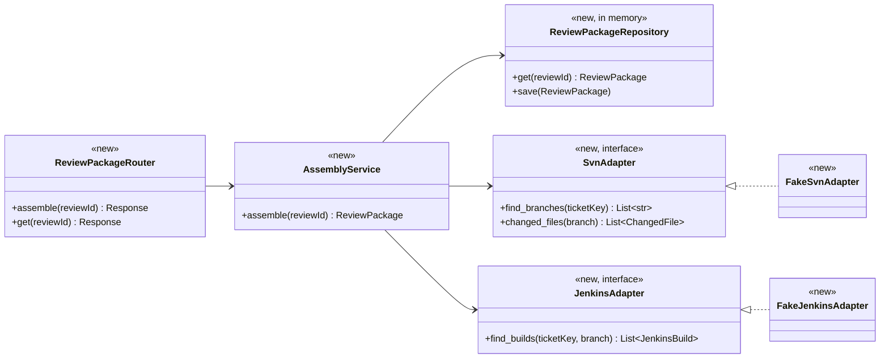
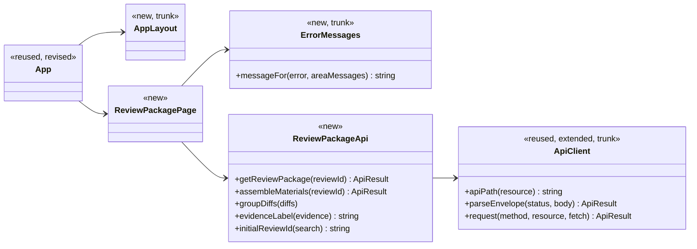
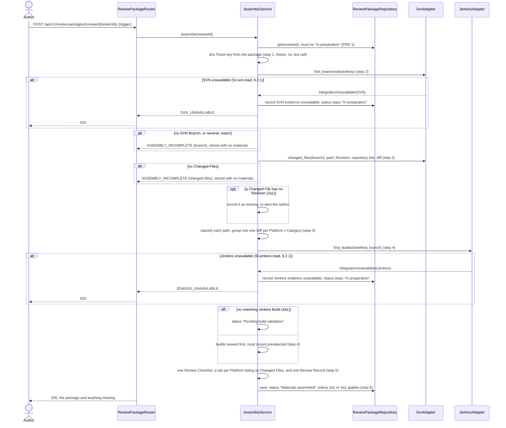
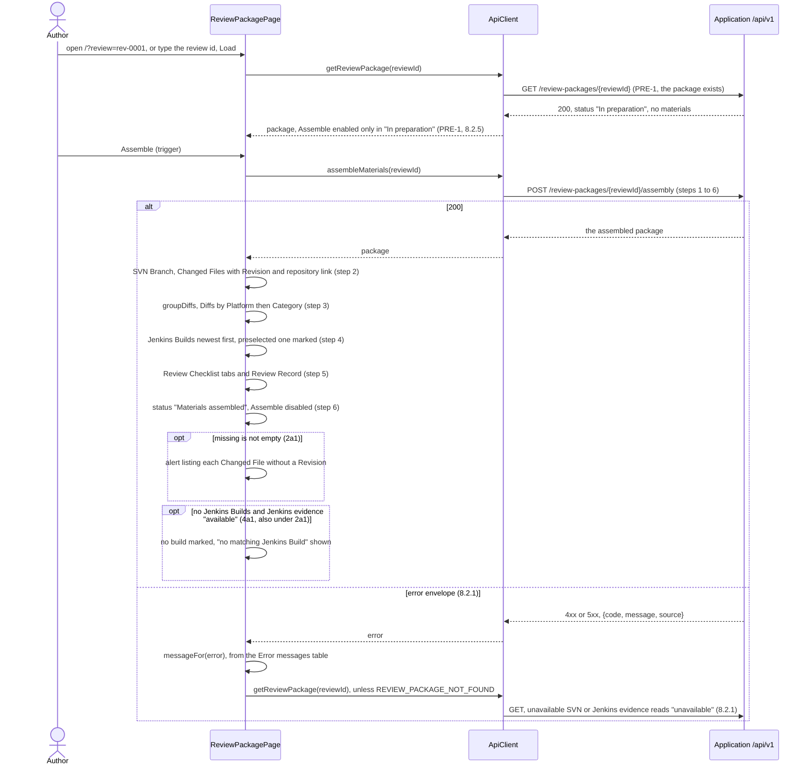

# Review Preparation Design

**Project:** RevView/OMNI
**Team:** Team 8
**Area:** `UC-REV`

> **Realizes:** [`UC-REV-assemble-materials`](../requirements/use-cases.md#uc-rev-assemble-materials-assemble-review-materials) (main success scenario, extensions 2a1 and 4a1; the review package page, issue #51)
> **Depends on:** `BR-review-package-required`, `BR-svn-diff-required`, `BR-diff-checklist-match`, `BR-review-nine-parts` ([business rules](../requirements/business-rules.md), read as the [2026-11-06 client meeting](../requirements/client-meeting/client-interview-2026-11-06.md) reshaped them); `SI-svn-read`, `SI-jenkins-read`, `ROB-incomplete-package-blocked`, `SEC-authenticated-access` (deferred, see Open questions), `CO-sandbox-development` ([specification](../requirements/software-requirements-specification.md)); [architecture-of-record](architectural-design.md) sections 8.2.1, 8.2.2, 8.2.3, 8.2.4, 8.2.5, 8.2.10
> **See:** [use cases](../requirements/use-cases.md), [specification](../requirements/software-requirements-specification.md), [architecture-of-record](architectural-design.md), [glossary](../requirements/project-glossary.md)
> **Designed against:** `c888a31` (`main`) plus `5a32b1d` (PR #41, the 2026-11-06 client meeting record, not yet merged); the review package page against `2c9a805` (`main`)

---

_**How to use this template.** Copy it to `docs/design/<area>.md`, named for the lowercase area code (`ord.md` for `UC-ORD-*`). Instructions appear in italic square brackets; leave them in place until the document is stable, because the agent reads them on every later pass. The full worked example is Project Pulse's [`not.md`](https://github.com/Washingtonwei/project-pulse/blob/main/docs/design/not.md); read it for the shape, not for the answers._

_**What this document is.** The **design-of-record** for one use case area: how the code will realize its use cases, written **before** the code and approved before anyone builds from it. It is the last document your agent reads before it writes code, so anything it leaves out, the agent invents._

_**What it is not.** A copy of your use cases. It **cites** `UC-*`, `FR-*`, and `BR-*` by identifier and never restates what the system shall do; it says only how._

_**One document per area, not per use case.** The overview, the class diagram, and the data model are **revised in place**. The sequence diagrams, the API contract rows, and the test rows are **appended**, one set per use case. Never add a `## UC-…` section that repeats the whole skeleton._

_**How much to write.** Pin down what a wrong guess would break: a requirement, a business rule, a quality attribute, or the contract between two parts of your team. Leave the rest for the agent to derive while it builds._

---

## Overview

_[One paragraph: what this area does, which components of the architecture-of-record it lives in, and what it reads from or calls in other areas.]_

Review Preparation takes a review package from "In preparation" to "Materials assembled": it finds the SVN Branch for the package's Jira Ticket, collects the Changed Files, Revisions, and Diffs, links candidate Jenkins Builds, and attaches the Review Checklist and Review Record. It is the `REV` area's Review Preparation component ([use case areas](architectural-design.md#52-use-case-areas-and-components)) and reaches SVN and Jenkins only through Integration Gateway adapters (section 8.2.4).

**v0.1.0 shortcuts, deliberate:**

- **The review package comes from a fixture.** `UC-REV-create-review` is not built, so a synthetic package in "In preparation" is seeded at startup. It already holds the Jira Ticket key, so step 1 reads the key from the package and **makes no Jira call**.
- **The SVN and Jenkins adapters are fakes** returning Synthetic Data (`CO-sandbox-development`, section 8.2.10). The real sandbox adapters replace them behind the same interfaces.
- **Storage is in memory.** Nothing survives a restart. PostgreSQL (`CO-database`) arrives with the first use case that needs persistence.

**Package shape.** The shape follows the 2026-11-06 meeting (`OI-31`, `OI-36`), not specification section 7.1. A package has one Review Checklist with one tab per Platform (common, falcon, phoenix), one Review Record, and one Diff per Platform × Code/Tools/Tests Category the change touches, up to nine. The specification and business-rule edits follow in a separate pull request.

**The review package page.** An Author loads a review package by its review id, presses Assemble, and sees the assembled materials, the gaps flagged by 2a1, and any failure as a message they can act on. It runs in the Web Interface container ([section 5.1](architectural-design.md#51-containers)) and calls only the two endpoints below. Its frontend shell (the layout, the API client, and the error-envelope handling) is **shared code, the trunk**: later use cases reuse it, so it merges before any page built on it. In v0.1.0 the page reaches the API through Vite's development proxy; serving the built pages from the Application (`KD-deployment-shape`) comes later.

## Components & classes

_[One class diagram for the whole area, and one line per class or file saying what it does and whether it is **new** or **reused**. If the repository has no code for this area yet, list the files you expect the agent to create and mark them all new.]_



- `backend/app/rev/router.py` (new): the two endpoints. It validates the request shape and nothing else.
- `backend/app/rev/assembly.py` (new): `AssemblyService`, steps 1 to 6 with the extensions below, and `classify(path)`, which maps a repository path to a Platform and a Code/Tools/Tests Category.
- `backend/app/rev/models.py` (new): Review Package, Changed File, Diff, Jenkins Build, Review Checklist (Platform tabs), Review Record.
- `backend/app/rev/repository.py` (new): the in-memory store.
- `backend/app/rev/fixtures.py` (new): one synthetic review package in "In preparation", with a placeholder ticket key.
- `backend/app/integration/common.py` (new): `IntegrationUnavailable(source)`, which every adapter raises when its system does not answer, and `contains_ticket_key`, the key match every adapter uses.
- `backend/app/integration/svn.py` (new): `SvnAdapter` and `FakeSvnAdapter`.
- `backend/app/integration/jenkins.py` (new): `JenkinsAdapter` and `FakeJenkinsAdapter`. It is **read only and has no method that starts a build** (`OI-35`).
- `backend/app/errors.py` (new): turns `IntegrationUnavailable`, the area's errors, request validation errors, unknown routes, and unexpected exceptions into the section 8.2.3 envelope at the trust boundary (section 8.2.1). It is registered in `backend/app/main.py` (reused).
- The adapters and the repository are FastAPI dependencies, declared in `router.py`, so tests swap in fakes that fail or return other data. No new packages. `backend/pyproject.toml` now finds `app*` packages, so the new subpackages are installed.

### The review package page (issue #51)



All under `frontend/`. **Trunk** marks shared code later use cases reuse.

- `src/api.ts` (reused, extended, **trunk**): keeps `apiPath`. Adds `parseEnvelope`, a plain function from an HTTP status and parsed body to either the `data` or the `{code, message, source}` of the section 8.2.3 envelope; a body that is neither becomes the client-side code `API_UNREACHABLE`. Adds `request`, which calls `fetch` (passed in, so tests replace it) and gives `API_UNREACHABLE` when the fetch rejects or the body is not JSON.
- `src/errors.ts` (new, **trunk**): `messageFor`, the Author's message for an error: the shared codes and the fallback in the table below, plus the messages an area passes in for its own codes.
- `src/AppLayout.tsx` (new, **trunk**): the product name and a main region. No navigation, since there is one page.
- `src/App.tsx` (reused, revised): renders `AppLayout` around `ReviewPackagePage`.
- `src/rev/reviewPackage.ts` (new): types mirroring `backend/app/rev/models.py`; `getReviewPackage` and `assembleMaterials`; the area's error messages; and the plain functions `groupDiffs` (Platform in common, falcon, phoenix order, then Category in code, tools, tests order), `evidenceLabel`, and `initialReviewId` (the `review` query parameter, or empty).
- `src/rev/ReviewPackagePage.tsx` (new): a review id input with Load, prefilled from `?review=` with no default; an Assemble button, enabled only while the status is "In preparation"; and the package: status, SVN Branch, SVN and Jenkins evidence, the Diffs grouped by Platform then Category with each Changed File's path, Revision, and repository link and the diff text in a collapsed block, the Jenkins Builds newest first with their result and the preselected one marked, the Review Checklist as one tab per Platform listing its Changed Files, the Review Record id, and `missing` (2a1) as an alert. Build times show in UTC, labelled "UTC" (see Open questions).
- `vite.config.ts` (reused, revised): a development-server proxy sending `/api` to `http://127.0.0.1:8000`. Configuration only.
- `README.md` (reused, revised): a "Run the page" section.
- Tests: `src/api.test.ts` (extended), `src/errors.test.ts` (new), `src/rev/reviewPackage.test.ts` (new). No new packages.

## Sequence

_[One sequence diagram per use case for its main success scenario. **Label each interaction with the use case step it implements.** Use `alt` blocks for extensions.]_

### UC-REV-assemble-materials: assembling review materials



**Status after assembly.** It is "Materials assembled" only when nothing is missing. A missing Revision (2a1) leaves "In preparation" with the gap listed, because POST-2 asks for the gap to be flagged for correction. No matching build (4a1) gives "Pending build validation". When both apply, 2a1 wins, since the package cannot be assembled without its Revisions.

### UC-REV-assemble-materials: the review package page



## API contract

_[One row per endpoint. **This section is never dropped.** Use the error shape section 8.2 fixes.]_

All responses use the section 8.2.3 envelope: `{"data": …}` or `{"error": {"code", "message", "source"}}`.

| Endpoint or job | Caller (who may) | Request | Success | Errors, by extension |
|---|---|---|---|---|
| `POST /api/v1/review-packages/{reviewId}/assembly` | The package's Author. v0.1.0 has no authentication (see Open questions) | None | `200`: the package, with its status, SVN Branch, Diffs (each with its Platform, Category, and Changed Files with Revision and repository link), candidate Jenkins Builds newest first with one preselected, the Review Checklist tabs, the Review Record, and `missing` (the Changed Files without a Revision, 2a1). 4a1: status "Pending build validation", no build preselected | SVN unavailable: `503 SVN_UNAVAILABLE`, `source: "SVN"`. Jenkins unavailable: `503 JENKINS_UNAVAILABLE`, `source: "Jenkins"`. No branch, several branches, no Changed Files, or an unclassifiable path: `409 ASSEMBLY_INCOMPLETE`, the message naming which (and the path). Package not "In preparation" (PRE-1, which also refuses a re-run once past "In preparation"): `409 REVIEW_PACKAGE_NOT_IN_PREPARATION`. Unknown id: `404 REVIEW_PACKAGE_NOT_FOUND` |
| `GET /api/v1/review-packages/{reviewId}` | Same | None | `200`: the stored package as above. After an SVN or Jenkins outage, that evidence reads `unavailable` | `404 REVIEW_PACKAGE_NOT_FOUND` |

**Example `200` body** (main success scenario, Synthetic Data):

```json
{
  "data": {
    "review_id": "rev-0001",
    "status": "Materials assembled",
    "jira_ticket_key": "SYN-1",
    "svn_branch": "SYN-1-timer-fix",
    "svn_evidence": "available",
    "jenkins_evidence": "available",
    "diffs": [
      {
        "platform": "common",
        "category": "tools",
        "diff": "Index: tools/common/branches/SYN-1-timer-fix/src/timer.py\n...",
        "changed_files": [
          {
            "path": "tools/common/branches/SYN-1-timer-fix/src/timer.py",
            "revision": "1042",
            "repository_link": "https://svn.example.invalid/repo/tools/common/branches/SYN-1-timer-fix/src/timer.py?p=1042"
          }
        ]
      }
    ],
    "jenkins_builds": [
      { "build_number": 57, "name": "SYN-1 timer fix", "result": "SUCCESS", "built_at": "2026-11-05T14:02:11Z" },
      { "build_number": 55, "name": "SYN-1 timer fix", "result": "FAILURE", "built_at": "2026-11-04T09:40:03Z" }
    ],
    "preselected_build": 57,
    "review_checklist": {
      "tabs": [
        { "platform": "common", "changed_files": ["tools/common/branches/SYN-1-timer-fix/src/timer.py"] }
      ]
    },
    "review_record": { "id": "rr-0001", "review_id": "rev-0001", "jira_ticket_key": "SYN-1" },
    "missing": []
  }
}
```

- Statuses are the use case's display strings exactly. Field names are snake_case. `platform` and `category` are lowercase, spelled exactly as the path segment. Paths are full repository paths, and the same string appears in the Diff, the checklist tab, and `missing`.
- `missing` entries read `{"path": …, "missing": "revision"}`. `preselected_build` is `null` under 4a1. `svn_evidence` and `jenkins_evidence` are `"available"`, `"unavailable"`, or `null` when that system has not been asked yet: before the first assembly, and `jenkins_evidence` after an SVN outage, since Jenkins is not queried then.
- After an SVN or Jenkins outage, or an `ASSEMBLY_INCOMPLETE`, the stored package has no materials (no branch, Diffs, builds, checklist, record, or `missing`), with each system's evidence as observed: a Jenkins outage stores `svn_evidence: "available"`, `jenkins_evidence: "unavailable"`; an `ASSEMBLY_INCOMPLETE` stores `svn_evidence: "available"`, `jenkins_evidence: null`. Nothing half-assembled or left over from an earlier run is stored.
- The Review Checklist has a tab for each Platform the change touches, in common, falcon, phoenix order; Diffs are in Platform then Category order, and files within a Diff by path. The Review Record id is the review id with `rev-` replaced by `rr-`.
- Errors: `source` is `null` when no external system is involved. `ASSEMBLY_INCOMPLETE` names the gap in `message` only. `reviewId` is an opaque string, and any unknown one gives `404`.

The review package page uses these two rows as they stand.

### Error messages

What the page shows the Author for each code. The code itself is shown in small text under the message, for support.

| Code | Message shown to the Author | Then the page |
|---|---|---|
| `SVN_UNAVAILABLE` | SVN did not respond, so the Changed Files could not be read. Nothing was assembled and the package is still In preparation. Try Assemble again later. | Reloads the package; SVN evidence shows "unavailable" |
| `JENKINS_UNAVAILABLE` | Jenkins did not respond, so the Jenkins Builds could not be read. Nothing was assembled and the package is still In preparation. Try Assemble again later. | Reloads; Jenkins evidence shows "unavailable", never passing |
| `ASSEMBLY_INCOMPLETE` | The materials could not be assembled: {the server's message}. | Reloads. The server's message is the only place the gap is named (no SVN Branch, several, no Changed Files, or the unclassifiable path) |
| `REVIEW_PACKAGE_NOT_IN_PREPARATION` | Materials can be assembled only while the package is In preparation. This package is already past that. | Reloads, showing its status |
| `REVIEW_PACKAGE_NOT_FOUND` | There is no review package with the id {reviewId}. Check the id and load it again. | Clears the package |
| `VALIDATION_FAILED` | The request was not valid. Check the review id. | Nothing more |
| `INTERNAL_ERROR` | Something went wrong in RevView/OMNI. Try again; if it keeps happening, tell the maintainer. | Nothing more |
| Any other code (`NOT_FOUND`, `METHOD_NOT_ALLOWED`, `REQUEST_FAILED`, or a future one) | The request could not be completed ({code}). | Nothing more |
| `API_UNREACHABLE` (client-side; no envelope came back) | RevView/OMNI could not be reached. Check that the application is running. | Nothing more |

The first five rows are the area's and live in `src/rev/reviewPackage.ts`; the rest are the trunk's, in `src/errors.ts`. `API_UNREACHABLE` is never sent by the server: it covers a refused connection, or the proxy's own error page when the Application is not running.

## Key decisions

_[Only the decisions a reader could not recover from the code. **Each one names what you chose, what you rejected, and why.**]_

**SVN unavailable is a `503` plus a stored "unavailable".** Rejected: `200` with an unavailable flag, because a 2xx is too easily read as passing evidence (section 8.2.1, `SI-svn-read`). Jenkins is not queried, since the build match needs the branch.

**No matching Jenkins Build is a `200` in "Pending build validation" (4a1).** Rejected: an error, because the use case makes it a state the author resolves by running a build when prompted (`OI-35`). Missing branch and missing files remain errors because there is nothing to assemble.

**Platform and Category come from the repository path.** A path of the form `<category>/<platform>/branches/<branch>/…` (for example `tools/common/branches/<ticket>/…` is common, tools) decides both. Rejected: the author choosing per file, and file-type rules (the team's reading of `OI-32`).

**Jenkins evidence is per package, not per section.** Matching builds (the ticket key in the build name or description, and the branch-name parameter equal to the SVN Branch) are listed newest first, with the most recent preselected. Rejected: one build per section, because a build belongs to a branch, and every section needs evidence (`OI-33`, `OI-34` reconciled).

**The Jenkins adapter cannot start a build.** Rejected: triggering a build when none matches, because the client said to prompt the author (`OI-35`).

**Assembly proceeds only on exactly one SVN Branch whose name contains the ticket key.** None, or several, gives `409 ASSEMBLY_INCOMPLETE` (branch). When several match, the author should choose (`OI-29`); that choice is not built in v0.1.0, and the fixture has exactly one match. Rejected: taking the first match, which would silently assemble evidence from the wrong branch.

**The store is in memory.** Rejected: PostgreSQL in v0.1.0, because the slice proves the assembly flow and the adapters, not persistence. The repository interface is the seam the database replaces.

**The review package page (issue #51):**

- **One page, chosen by a query parameter and an input; no router.** `?review=<id>` prefills the review id input, and Load reads it. Rejected: a router library, a dependency for one page; and hand-written path routing, which is scope with no second page to route to.
- **The page reaches the API through Vite's development proxy.** Rejected: CORS middleware on the backend, which changes a released endpoint and opens a cross-origin path the one-deployable shape (`KD-deployment-shape`) never needs.
- **The page's logic is in plain functions, unit-tested with Vitest; nothing renders in a test.** Rejected: component tests, which need a testing library and a browser-environment package nobody has confirmed (charter: a person confirms every dependency).
- **After any error except `REVIEW_PACKAGE_NOT_FOUND`, the page reloads the package.** Rejected: showing only the message, because the stored "unavailable" evidence (section 8.2.1) and the unchanged status would not be visible.
- **Assemble is enabled only while the status is "In preparation".** This is a convenience (section 8.2.5); PRE-1 is enforced by the API, and its `409` is still mapped for a second tab. Rejected: always enabled, which invites a click that can only fail.
- **Each area keeps its own error messages; the shared codes and the fallback are in the trunk.** Rejected: one table for every area, which each later use case would edit and conflict on. An unknown code gets the fallback with the code, never a blank.

**Page implementation rules** (from the questions test on issue #51):

- "No matching Jenkins Build" shows whenever the Jenkins Builds are empty and Jenkins evidence is "available", whatever the status, because 2a1 and 4a1 together leave "In preparation".
- Build times show as `YYYY-MM-DD HH:MM:SS UTC`, read with UTC methods only; never local time labelled UTC.
- `parseEnvelope` takes `data` only from a 2xx and `error` only from a non-2xx; any other combination is `API_UNREACHABLE`, so a failure is never shown as success (section 8.2.1).
- The review id is trimmed and `encodeURIComponent`-encoded in the path; Load is disabled while it is blank.
- Load and Assemble are disabled while a request runs. If the reload after an error fails too, both messages show and the package is cleared, so stale evidence is never left on screen.
- Diff text, paths, and server messages are rendered as text; never as raw HTML.

**Implementation rules** (from the questions test):

- The SVN Branch is a name, and `changed_files` searches every `<category>/<platform>/branches/<name>` root.
- Key match: case-sensitive, and the key must not be preceded by a letter or digit nor followed by a digit (`SYN-10-cleanup` and `ASYN-1-refactor` do not match `SYN-1`).
- Any adapter failure on any call → `503 <SOURCE>_UNAVAILABLE`, evidence recorded as `unavailable`, status unchanged.
- An unclassifiable path → `409 ASSEMBLY_INCOMPLETE` naming the path.
- A 2a1 file still goes into its Diff and its checklist tab.
- Builds are listed with their result; the newest is preselected whatever its result.
- Timestamps are UTC ISO 8601 with `Z`.
- Envelope handlers for validation errors (`VALIDATION_FAILED`), unknown routes (`NOT_FOUND`), a method a route does not allow (`405 METHOD_NOT_ALLOWED`), any other HTTP error (`REQUEST_FAILED`), and unexpected errors (`INTERNAL_ERROR`), with safe messages.
- Log one line per assembly (review id, outcome, code), never diff or source content.
- Assemblies run one at a time (a lock), so two requests cannot both pass PRE-1 and overwrite each other (section 8.2.8); the in-memory store has no transactions.

## Data model

_[The **change** this area makes to the data. If nothing changes, say "No change" and give the reason.]_

No database change: v0.1.0 holds review packages in memory (see Overview). The package shape departs from specification section 7.1 as described in the Overview. The domain-model and business-rule edits follow in a separate pull request.

The review package page stores nothing; it shows what the API returns.

## Reuse & cross-cutting

_[Which existing services, components, and conventions this area uses rather than rebuilding.]_

- The FastAPI app in `backend/app/main.py` (reused). The new router mounts under `/api/v1` beside `GET /api/v1/health`.
- Error handling: section 8.2.1, one translation in `backend/app/errors.py`.
- API conventions: section 8.2.3, the envelope.
- Code conventions: section 8.2.4. The area lives in `app/rev/`, and the adapters in `app/integration/`.
- Testing: section 8.2.10, Synthetic Data only. The tests use FastAPI's `TestClient` as `backend/tests/test_health.py` does.
- Not used in v0.1.0: the clock (section 8.2.2), because assembly stores no timestamp of its own and build order comes from Jenkins's build times; and auditing (section 8.2.9), because assembly is not among the transitions it lists.
- The page: `apiPath` in `frontend/src/api.ts` (reused), and the section 8.2.3 envelope read once, in `parseEnvelope`. Browser checks (the disabled Assemble button) are convenience only (section 8.2.5). Times are displayed in UTC until the organization time zone (section 8.2.2) is known.

## Tests

_[One row per flow: the main success scenario and **every** extension this document realizes. No code.]_

| Use case, flow | Level | Asserts |
|---|---|---|
| UC-REV-assemble-materials main | integration | The fixture package's POST returns `200` with status "Materials assembled"; the SVN Branch matched; one Diff per Platform × Category touched and no other; every Changed File has a Revision and a repository link; each Review Checklist tab lists exactly the Changed Files in that Platform's Diffs (`BR-diff-checklist-match`); one Review Record; builds newest first with the most recent preselected; the Jenkins fake received no start-build call; the GET returns the same package |
| UC-REV-assemble-materials step 3 | unit | `classify` maps each Platform × Category path to the right pair, for example `tools/common/branches/<ticket>/…` to common, tools |
| UC-REV-assemble-materials 2a1 | integration | A Changed File without a Revision returns `200` with that file in `missing`, and the status stays "In preparation" |
| UC-REV-assemble-materials 4a1 | integration | No matching Jenkins Build returns `200` with status "Pending build validation" and no build preselected |
| 2a1 and 4a1 together | integration | Status stays "In preparation" (2a1 wins), no build preselected |
| SVN unavailable (`SI-svn-read`, 8.2.1) | integration | A failing SVN fake gives `503 SVN_UNAVAILABLE` with `source: "SVN"`; the GET shows "In preparation", SVN evidence `unavailable`, and no Diffs; Jenkins was not called |
| Jenkins unavailable (`SI-jenkins-read`, 8.2.1) | integration | A failing Jenkins fake gives `503 JENKINS_UNAVAILABLE` with `source: "Jenkins"`; the GET shows "In preparation" and `jenkins_evidence` `unavailable`, never "Pending build validation" |
| No branch, several branches, no Changed Files | unit | Each gives `409 ASSEMBLY_INCOMPLETE` naming the gap; the status is unchanged, no materials are stored, and `svn_evidence` reads `available` |
| Re-run that hits `409` | integration | After an outage, or after 2a1, a re-run giving `ASSEMBLY_INCOMPLETE` leaves no stale materials and `svn_evidence` `available` |
| PRE-1 | integration | A second POST on an assembled package gives `409 REVIEW_PACKAGE_NOT_IN_PREPARATION` |
| Unknown package | integration | `404 REVIEW_PACKAGE_NOT_FOUND` on the POST and the GET |
| Page: envelope success (8.2.3) | unit (Vitest) | `parseEnvelope` of a `200` with `data` returns the data |
| Page: envelope error (8.2.1) | unit (Vitest) | `parseEnvelope` of a `503` error envelope returns its code, message, and source unchanged |
| Page: API unreachable | unit (Vitest) | A rejected fetch, a body that is not JSON, or a body with neither `data` nor `error` gives `API_UNREACHABLE` |
| Page: every extension's error code | unit (Vitest) | `messageFor` gives the Error messages table's message for each of the seven API codes; `ASSEMBLY_INCOMPLETE` includes the server's message; `REVIEW_PACKAGE_NOT_FOUND` includes the review id; an unknown code gives the fallback naming the code |
| Page: step 3 grouping | unit (Vitest) | `groupDiffs` orders Platforms common, falcon, phoenix and Categories code, tools, tests, keeps each Diff's Changed Files, and gives nothing for no Diffs |
| Page: evidence (8.2.1) | unit (Vitest) | `evidenceLabel` gives "available", "unavailable", and "not read yet" for `null`; never a passing word for `unavailable` |
| Page: choosing the package | unit (Vitest) | `initialReviewId("?review=rev-0001")` is `rev-0001`; with no parameter it is empty |
| Page: main success scenario, PRE-1, unknown package | manual, end to end | With the API and `npm run dev` running ("Run the page" in `README.md`), `/?review=rev-0001`: Load shows "In preparation" and no materials; Assemble shows "Materials assembled", SVN Branch `SYN-1-timer-fix`, the Diffs grouped with Revisions and links, build 57 marked preselected, the Review Checklist tabs, and Assemble disabled; loading `rev-9999` shows the not-found message. Recorded in the pull request under How it was verified |

## Changes to the architecture-of-record

_[List each change to the architecture-of-record in one line, or "None".]_

- Section 8.2.3 now defines the success and error envelope it already required, with the `source` field section 8.2.1 calls for.
- Sections 8.2.1 and 8.2.3 now also cite `frontend/src/api.ts` and `frontend/src/errors.ts` as where the browser reads the envelope (issue #51).

## Open questions & risks

_[What this design could not settle and who can, and what could go wrong that you are accepting.]_

- **The fakes do not retire `RISK-sandbox-integration-unproven` or `RISK-svn-from-python`.** Those were the reasons this use case is the proving slice. The Integration Gateway stays `provisional` until the real sandbox adapters pass the same tests.
- **The assembly log line is not emitted by the running app yet.** No logging configuration exists, so `app.*` INFO messages are dropped at the root's default level; the test reads them directly. Configuring logging for the application (section 8.2.7, with a request correlation id) is a follow-up.
- **`SEC-authenticated-access` is deferred.** There is no Identity component yet, so v0.1.0 runs on a developer's machine only and must not be exposed on a network.
- **Unclassifiable paths.** A path outside the `<category>/<platform>/…` pattern has no rule. The fixture avoids it. It goes to Sumalee with the `OI-32` confirmation.
- **Assumptions to confirm with Sumalee Rodolph** (the team's readings of the 2026-11-06 meeting, treated as decided for this slice): `OI-29` (match the ticket key in the branch name; several → the author picks; none → blank), `OI-31` and `OI-36` (the package shape above), `OI-32` (the path rule), `OI-33` and `OI-34` (every section needs build evidence; newest first, most recent preselected), `OI-35` (prompt, never start a build), `OI-38` (SVN will have the information). Also, a Review Section in this shape is a Platform tab of the one Review Checklist.
- **Re-running while "In preparation" is allowed.** A POST on a package still "In preparation" (after 2a1 or an outage) runs assembly again and overwrites the stored result, including any `unavailable` evidence. PRE-1 refuses only a package past "In preparation".
- **PRE-2 and PRE-3 are not checked in v0.1.0.** PRE-2 (the author's permission) needs the Identity component, which is deferred with `SEC-authenticated-access`. PRE-3 (a section needing evidence) cannot be checked before assembly, because a section is a Platform tab and the tabs are built by assembly; every section needs build evidence anyway (`OI-33`).
- **The page cannot show 2a1, 4a1, or an SVN or Jenkins outage against the running app,** because the fixture always takes the main path. The backend tests and the page's unit tests cover them; showing them to Sumalee would need another fixture, which is out of scope.
- **The page's rendering is not tested automatically** until a component-testing library is confirmed; the manual check covers it.
- **Which organization time zone to display is unknown** (section 8.2.2, `OI-39`). The page shows UTC, labelled.
- **The page has no authentication either** (`SEC-authenticated-access` deferred): developer machine only.
- **Out of scope for the page:** new or changed endpoints, serving the built pages from the Application, `UC-REV-create-review`, and placeholder screens for features that do not exist.
- **Out of scope for v0.1.0:** 2a2 (alternate change set, `OI-38`), 4a2 (the author running a build), 5a (missing checklist template), the author choosing among several branches or builds, merged-in work (`OI-30`), test and tools reviews (`OI-37`), real Jira, SVN, and Jenkins, re-running assembly once past "In preparation", and exporting the Review Checklist and Review Record.

---

## Working this document with your agent

_[Delegate: drafting the diagrams; listing the existing files a class should extend; filling the contract rows; proposing the test row for each extension; checking that every identifier this document cites exists._

_Keep human: which side of the "would a wrong guess break something" line each detail falls on; every key decision; and the approval, which is a teammate's review of the pull request._

_**The specific failure to watch for: scope that nobody asked for.** Read the sequence labels: every interaction should name the use case step it implements.]_

---

## The questions test (before you open the pull request)

_[Start a **fresh** agent session in plan mode. Give it only the use case, the business rules it cites, the architecture-of-record's section 8, and this document, and ask:_

> _List every point you would still have to guess to implement `UC-REV-assemble-materials`. For each, say what you would guess and whether a wrong guess could violate a requirement. Do not write code._

_For each item, either fix this document or keep the guess with one line saying why a wrong guess breaks no requirement. Paste the list into the pull request description under How it was verified, inside a collapsed `<details><summary>Questions test</summary> … </details>` block.]_
